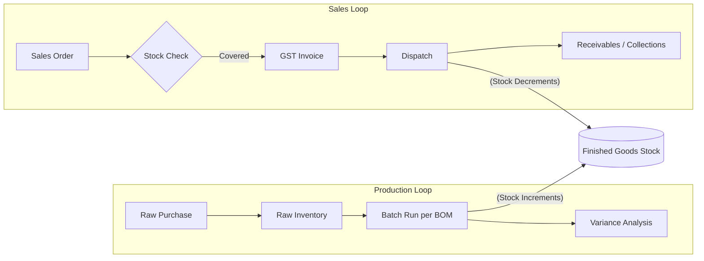
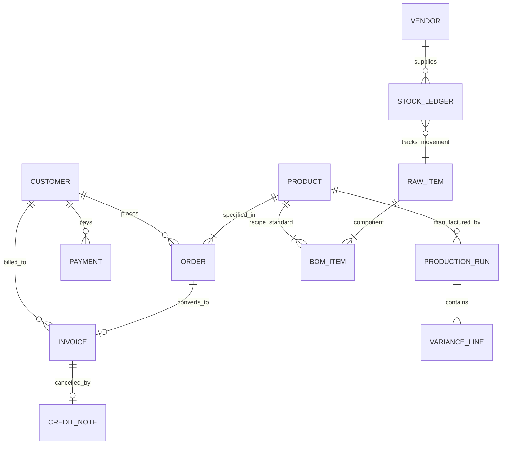

# DESIGN NOTE: Order-to-Audit ERP Architecture

**Project:** Order-to-Audit System for Small Food Manufacturers  
**Institution:** Centre for Digital Infrastructure, NIT Tiruchirappalli  
**Author:** Individual Submission · Candidate Task  

---

## 1. System Overview & The Dual-Loop Model

The **Order-to-Audit ERP** bridges two physical loops that meet at **Finished Goods Stock**:
- **Sales Loop:** Field Order $\rightarrow$ Stock Availability Check $\rightarrow$ GST Tax Invoice $\rightarrow$ Physical Dispatch $\rightarrow$ Accounts Receivable & Receipts.
- **Production Loop:** Raw Material Inward $\rightarrow$ BOM Recipe Issue $\rightarrow$ Batch Run & Scrap Tracking $\rightarrow$ Finished Goods Receipt $\rightarrow$ Variance Auditing.

---

## 2. Data Model & Entity-Relationship (ER) Schema

Every stock balance is derived strictly from a continuous immutable ledger of movements. Stock is never an isolated overwriteable number.

### Core Schema Definitions
1. **`STOCK_LEDGER`**: `{ id, it, q, val, src, note, date, ref }`
   - `it`: Item key (`flour`, `oil`, `spice`, `pouch`, `carton`, `mur`)
   - `q`: Signed quantity in milligram / millilitre integer units ($1\text{ kg} = 1,000,000\text{ mg}$; internal tracker unit $1,000\text{ m} = 1.000\text{ kg}$)
   - `val`: Signed value in integer paise ($₹1.00 = 100\text{ paise}$)
   - `src`: Traceable source document (`Purchase #1`, `Run #1`, `INV/2026-27/0001`, `Credit Note for ...`)
2. **`BOM_ITEM`**: `{ prodId, itemKey, standardQty, unit }`
   - Defines standard consumption per 1 batch (200 packets for Murukku 200g).

---

## 3. Stock Derivation & BOM Consumption Computation

### 3.1 Continuous Ledger Stock Derivation
Stock is derived dynamically at runtime:
$$\text{Closing Balance}(it) = \sum_{m \in \text{Ledger}, m.it = it} m.q$$
$$\text{Closing Value}(it) = \sum_{m \in \text{Ledger}, m.it = it} m.val$$
This guarantees complete audit traceability:
$$\text{Opening Balance} + \sum \text{Purchases} - \sum \text{Issues} - \sum \text{Dispatches} \pm \sum \text{Adjustments} = \text{Closing Balance}$$

### 3.2 Unit Conversions & Integer Representation
To prevent floating-point rounding creep (`0.1 + 0.2 \neq 0.3`):
- **Mass & Liquid:** Stored as thousandths ($1.000\text{ kg} = 1,000\text{ units}$; $10.5\text{ L} = 10,500\text{ units}$).
- **Packaging & Cartons:** $1\text{ carton} = 20\text{ pouches}$; $1\text{ pouch} = 1\text{ unit}$.
- **Currency:** Stored in integer paise ($₹7,875.00 = 787,500\text{ paise}$).

### 3.3 BOM Consumption, Wastage & Variance Analysis
For batch run $r$ with target yield $Y_{\text{exp}} = 200$ and actual good yield $Y_{\text{good}} = 188$:
1. **Planned Recipe Consumption:** $P_i = \text{BOM}_i \times (Y_{\text{good}} / Y_{\text{exp}})$
2. **Actual Store Issue:** $A_i$ entered by floor supervisor.
3. **Packaging Wastage:** Pouches consumed = $\text{Good Packets} (188) + \text{Damaged Pouches} (6) = 194\text{ pcs}$.
4. **Variance Ratio:**
   $$v_i = \frac{A_i - P_i}{P_i}$$
5. **Tolerance Trigger:** If $|v_i| > \text{TOL} \ (0.03)$, the system flags an audit alert ($\pm 3\%$ threshold).
   - *Benchmark Run 1:* Cooking oil issued = $10.5\text{ L}$ vs $10.0\text{ L}$ standard $\rightarrow v = +5.0\%$ (**Flagged ⚑**).
   - *Yield Variance:* $(188 - 200) / 200 = -6.0\%$ (**Flagged ⚑**).

---

## 4. Costing & Valuation Methodology

### 4.1 Justification for Weighted-Average Costing
We adopted **Weighted-Average Valuation** over FIFO and LIFO:
- In small snack manufacturing, ingredients like flour and cooking oil are poured into continuous storage bins or bulk tanks upon delivery. Physically isolating distinct batches (FIFO) is impractical for loose flour silos and oil drums.
- Weighted-average reflects the actual blended economic cost of bulk commodity inputs without artificial step-jumps in packet costing.

$$\bar{C}_{it} = \frac{V_{\text{current}} + (Q_{\text{new}} \times R_{\text{new}})}{Q_{\text{current}} + Q_{\text{new}}}$$

*Benchmark Example (Flour):*
- Opening: $100\text{ kg} @ ₹42 = ₹4,200$
- Inward: $60\text{ kg} @ ₹45 = ₹2,700$
- Blended Unit Rate: $₹6,900 / 160\text{ kg} = ₹43.125\text{ / kg}$

### 4.2 Raw Material Consumption Valuation
When ingredients are issued to Run #1, value is credited from raw stores at weighted-average:
- Flour: $40\text{ kg} \times ₹43.125 = ₹1,725.00$
- Cooking Oil: $10.5\text{ L} \times ₹140.00 = ₹1,470.00$
- Spices: $1.2\text{ kg} \times ₹200.00 = ₹240.00$
- Pouches (188 good + 6 scrap): $194\text{ pcs} \times ₹2.50 = ₹485.00$
- Cartons: $9\text{ pcs} \times ₹15.00 = ₹135.00$
- **Total Materials Consumed:** $₹4,055.00$

### 4.3 Direct Overhead Allocation Rule
Overheads (labour, power, fuel) are assigned directly per production batch based on logged machine hours and labor rosters:
- Factory Labour: $₹1,200.00$
- Gas & Power Overheads: $₹600.00$
- **Total Allocated Overheads:** $₹1,800.00$

### 4.4 Unit Costing and Margin Equation
$$\text{Total Batch Cost} = \text{Materials } (₹4,055.00) + \text{Overheads } (₹1,800.00) = ₹5,855.00$$
$$\text{Cost per Packet} = \frac{₹5,855.00}{188\text{ good packets}} = \mathbf{₹31.14} \text{ / packet}$$
$$\text{Gross Margin} = \frac{₹50.00 - ₹31.14}{₹50.00} \times 100 = \mathbf{37.7\%}$$

---

## 5. Statutory Tax Determination & Traceability

1. **Intra-State (Tamil Nadu - State Code 33):**
   $$\text{Taxable} = 150 \times ₹50 = ₹7,500.00$$
   $$\text{CGST (2.5\%)} = ₹187.50, \quad \text{SGST (2.5\%)} = ₹187.50, \quad \text{Total} = ₹7,875.00$$
2. **Inter-State (Karnataka - State Code 29):**
   $$\text{IGST (5.0\%)} = \text{Taxable} \times 5\%$$
3. **Statutory Artifacts:**
   - Tax Invoice generated under CGST Rule 48 with HSN 1905.
   - Delivery Challan generated under CGST Rule 55.
   - Electronic Way Bill generated under CGST Rule 138 (Form GST EWB-01).
   - Tally XML Daybook vouchers & official GSTR-1 JSON export for `gst.gov.in`.
