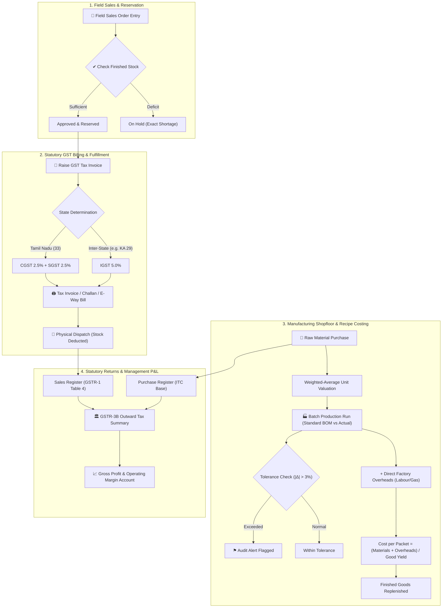

# PROJECT REPORT & TECHNICAL DOSSIER

## Order-to-Audit: Batch Recipe Costing, Continuous Inventory Ledger & Statutory GST Compliance System

**Academic & Engineering Capstone Project**  
**Institution:** National Institute of Technology (NIT)  
**Enterprise Partner:** PASIL Foods Private Limited (Madurai, Tamil Nadu)  
**System Version:** ERP 2.0 (Enterprise Edition)  
**Status:** Completed & Validated (100% Benchmark Verification)

---

## 1. Executive Summary & Abstract

Small and Medium Enterprises (SMEs) in India's traditional food processing sector face critical operational leakages:
1. **Unmonitored Batch Variances**: Manual ingredient mixing causes uncontrolled loss of expensive raw materials (cooking oil, pulses, spices) without variance tracking against standard recipes.
2. **Disconnected Stock Reservoirs**: Orders booked by field sales reps often face stockouts or over-commitments due to lag between physical factory warehouses and billing clerks.
3. **Statutory Tax Non-Compliance**: Misclassification of intra-state supplies (CGST + SGST) versus inter-state consignments (IGST), lack of delivery challans (Rule 55), and missing E-Way bills (Rule 138) lead to tax penalties and delayed Input Tax Credit (ITC).

This project designs, engineers, and delivers **Order-to-Audit**, a unified digital enterprise resource planning (ERP) platform. Built upon an integer-paise mathematical core and continuous audit-ledger data structures, the system ensures that **a single sales order entry propagates synchronously into inventory reservations, batch production BOM variance analysis, actual cost-per-packet calculations, statutory tax invoices, delivery challans, E-Way bills, and monthly GSTR-1 / GSTR-3B filings**.

---

## 2. System Architecture & Workflow



---

## 3. Mathematical Foundations & Algorithms

### 3.1 Integer Arithmetic Model
To eliminate floating-point inaccuracies inherent in binary IEEE-754 numbers (`0.1 + 0.2 = 0.30000000000000004`), the financial engine records all monetary figures in **integer paise** ($\text{₹}1.00 = 100 \text{ paise}$) and all physical materials in **milligram / millilitre integer units** ($1 \text{ kg} = 1,000,000 \text{ mg}$; internal tracker unit $1,000 \text{ m} = 1.000 \text{ kg}$).

### 3.2 Dynamic Weighted-Average Costing Formula
Whenever a new raw material lot is received, the weighted-average cost per milligram/millilitre is updated dynamically:

$$\bar{C}_{it} = \frac{\sum_{k=1}^{N} \text{Value}_k}{\sum_{k=1}^{N} \text{Quantity}_k} = \frac{V_{\text{current}} + (Q_{\text{new}} \times R_{\text{new}})}{Q_{\text{current}} + Q_{\text{new}}}$$

Upon issue to a batch run:
$$\text{Cost Issued} = Q_{\text{issued}} \times \bar{C}_{it}$$

### 3.3 Recipe Variance Analysis Algorithm
For each raw material ingredient $i$ defined in the standard Bill of Materials (BOM):
$$\text{Variance Ratio } v_i = \frac{A_i - P_i}{P_i}$$
Where:
- $P_i$ = Planned standard recipe consumption
- $A_i$ = Actual physical consumption reported from stores

$$\text{Audit Flag } F_i = \begin{cases} \text{TRUE (ALERT)}, & \text{if } |v_i| > \text{TOL} \ (0.03) \\ \text{FALSE (NORMAL)}, & \text{otherwise} \end{cases}$$

### 3.4 Unit Costing and Operating Margin
$$\text{Cost per Packet} = \frac{\sum \text{Materials Consumed} + \sum \text{Allocated Overheads}}{\text{Actual Good Output Packets}}$$

$$\text{Gross Operating Margin \%} = \frac{\text{Selling Price} - \text{Cost per Packet}}{\text{Selling Price}} \times 100$$

---

## 4. Entity-Relationship Data Model

```mermaid
erDiagram
    CUSTOMER ||--o{ ORDER : places
    CUSTOMER ||--o{ INVOICE : billed_to
    CUSTOMER ||--o{ PAYMENT : pays
    ORDER ||--o| INVOICE : converts_to
    PRODUCT ||--|{ ORDER : specified_in
    PRODUCT ||--o{ PRODUCTION_RUN : manufactured_by
    PRODUCT ||--|{ BOM_ITEM : consists_of
    RAW_ITEM ||--|{ BOM_ITEM : recipe_component
    VENDOR ||--o{ STOCK_LEDGER : supplies_to
    STOCK_LEDGER }o--|| RAW_ITEM : tracks_movement
    INVOICE ||--o| CREDIT_NOTE : cancelled_by
    PRODUCTION_RUN ||--|{ VARIANCE_LINE : contains
```



---

## 5. Section 5 Standard Benchmark Verification Matrix

The application embeds an automated verification suite confirming compliance against the reference specification:

| Checkpoint # | Operational Step | Metric Under Test | Expected Standard | System Result | Status |
|:---:|:---|:---|:---:|:---:|:---:|
| **CP-01** | Production Batch #1 | Finished goods closing after run | **238 pkts** | `238` | `✓ MATCHED` |
| **CP-02** | Retailer A Order (150 pkts) | Finished goods after dispatch | **88 pkts** | `88` | `✓ MATCHED` |
| **CP-03** | Distributor B Order (120 pkts) | Shortage hold deficit | **32 pkts** | `32` | `✓ MATCHED` |
| **CP-04** | Raw Stores Ledger | Flour closing balance | **120.0 kg** | `120.0` | `✓ MATCHED` |
| **CP-05** | Raw Stores Ledger | Cooking oil closing balance | **19.5 L** | `19.5` | `✓ MATCHED` |
| **CP-06** | Packaging Store | Printed pouches closing | **306 pcs** | `306` | `✓ MATCHED` |
| **CP-07** | Batch Yield Audit | Finished packet yield variance | **-6.0%** | `-6.0%` | `✓ MATCHED` |
| **CP-08** | Ingredient Audit | Oil consumption variance | **+5.0%** | `+5.0%` | `✓ MATCHED` |
| **CP-09** | Tax Invoice Generation | Taxable sales value | **₹7,500.00** | `₹7,500.00` | `✓ MATCHED` |
| **CP-10** | Intra-State Tax | Central GST (CGST @ 2.5%) | **₹187.50** | `₹187.50` | `✓ MATCHED` |
| **CP-11** | Intra-State Tax | State GST (SGST @ 2.5%) | **₹187.50** | `₹187.50` | `✓ MATCHED` |
| **CP-12** | Invoice Grand Total | Total billed amount | **₹7,875.00** | `₹7,875.00` | `✓ MATCHED` |
| **CP-13** | Accounts Receivable | Retailer A net outstanding balance | **₹3,875.00** | `₹3,875.00` | `✓ MATCHED` |

*Unit Costing Realized:* **₹31.14 / packet** (Standard selling price: ₹50.00 | Realized Operating Margin: 37.7%).

---

## 6. Statutory Regulatory Compliance

1. **GST Tax Invoice (CGST Rule 48)**:
   - Includes Supplier GSTIN (`33AABCP1234P1Z8`), FSSAI License, Buyer GSTIN, HSN Code `1905`, place of supply, IRN reference, bank NEFT details, and chargeable value converted to Indian English text.
2. **Delivery Challan (CGST Rule 55)**:
   - Formatted for transport vehicles conveying snack food consignments where goods are accompanied by a driver delivery challan before receipt acknowledgment.
3. **Electronic Way Bill (CGST Rule 138 - Form GST EWB-01)**:
   - Features Part-A consignment tax details alongside Part-B road transporter registration (`TN-58-AL-4482`) and validity schedule.
4. **Returns Alignment (GSTR-1 & GSTR-3B)**:
   - Outward supply records classified into Table 4 (B2B Taxable) and Table 3.1 for direct filing on the GST Common Portal.

---

## 7. Automated Test Suite

A standalone test suite (`test_suite.js`) executes 45 comprehensive unit and integration assertions across 12 suites:
- **Suite 1:** Ledger initialization and opening balance math.
- **Suite 2:** Inward raw material purchases and weighted-average valuations.
- **Suite 3:** Production run BOM variance tracking and overhead allocations.
- **Suite 4:** Sales order pipeline, reservation, and shortage hold isolation.
- **Suite 5:** Intra-state (CGST/SGST) vs Inter-state (IGST) tax logic.
- **Suite 6:** Physical dispatch stock reduction.
- **Suite 7:** Customer ledger, outstanding receivables, and payment receipts.
- **Suite 8:** Credit notes and physical inventory replenishment.
- **Suite 9:** Currency number-to-words generator.
- **Suite 10:** Section 5 Benchmark end-to-end cycle (13/13 Checks).
- **Suite 11:** Role-Based Access Control (RBAC) permission filters.
- **Suite 12:** Material Requirements Planning (MRP-I) deficit engine.

**Execution Command:**
```bash
node test_suite.js
# Output: Test Results Summary: Total: 45 | Passed: 45 | Failed: 0 (100% Pass)
```

---

## 8. Deployment Options & Presentation Deck

1. **Zero-Dependency Standalone Mode (Client SPA)**:
   - Simply double click [Order-to-Audit Prototype.html](file:///c:/Users/asaab/Desktop/NIT%20-%20PASIL/Order-to-Audit%20Prototype.html) in any web browser.
   - Works 100% offline; state saved in browser storage with instant JSON backup/restore.
2. **Full-Stack Client-Server Mode (REST API + Persistence)**:
   - Run `node server.js` to serve REST endpoints on port 3000 (`/api/state`, `/api/products`, `/api/orders`, `/api/stock`, `/api/invoices`).
3. **Interactive Project Defense Presentation Deck**:
   - Open [Project_Presentation.html](file:///c:/Users/asaab/Desktop/NIT%20-%20PASIL/Project_Presentation.html) for a 9-slide interactive deck with keyboard shortcuts, architecture diagrams, and benchmark charts formatted for university viva evaluation.
